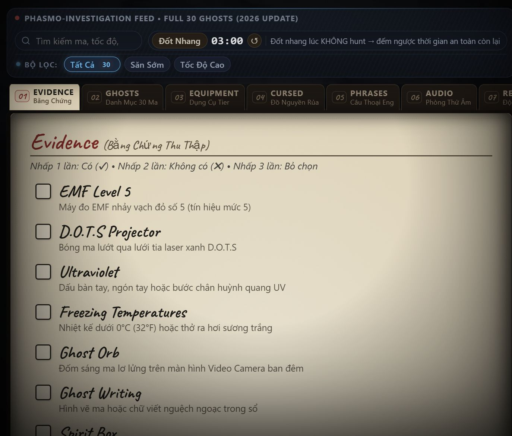

# 📓 Phasmophobia Investigation Journal

**Sổ tay thợ săn ma tiếng Việt** — tra cứu 30 loại ma, lọc bằng chứng, đồ nguyền rủa,
dụng cụ theo Tier, luyện nhận diện… tất cả trong một web tĩnh, không cần build.

🌐 **Dùng ngay (chỉ cần trình duyệt):** [phasmophobia-journal-livid.vercel.app](https://phasmophobia-journal-livid.vercel.app)

## ✨ Có gì trong sổ

Đúng **10 tab** như cuốn Journal trong game, giao diện sổ giấy:

| # | Tab | Nội dung |
| --- | --- | --- |
| 01 | **Evidence** — Bằng chứng | Tick 7 loại bằng chứng 3 trạng thái (có ✓ / không ✗ / bỏ chọn), mỗi loại kèm giải thích tiếng Việt |
| 02 | **Ghosts** — Danh mục 30 ma | Đủ 30 loại ma bản 2026: bằng chứng, tốc độ, hành vi |
| 03 | **Equipment** — Dụng cụ | Hệ thống dụng cụ theo Tier 1–3 |
| 04 | **Cursed** — Đồ nguyền rủa | Tarot, Ouija, Monkey Paw… (repo có sẵn 10 ảnh lá tarot trong `assets/tarot/`) |
| 05 | **Phrases** — Câu thoại Eng | Câu thoại tiếng Anh trong game (Spirit Box, kích thích ma…) |
| 06 | **Audio** — Phòng thử âm | Phòng thử âm của game |
| 07 | **Reference** — Độ khó & Map | Độ khó, bản đồ, tham chiếu nhanh |
| 08 | **Knowledge** — Kiến thức | Kiến thức tổng hợp |
| 09 | **Training** — Luyện nhận diện | Tự luyện suy luận nhận diện ma |
| 10 | **Manual** — Cẩm nang | Cẩm nang tiếng Việt ngay trong app |

Tiện ích thêm:

- 🔍 **Tìm kiếm nhanh** — bấm phím `/` — theo tên ma, tốc độ, bằng chứng…
- 🕯 **Đồng hồ Đốt Nhang (Smudge)** — đếm ngược 3:00 thời gian an toàn khi ma *không* hunt
- 🎚 **Bộ lọc nhanh:** Tất cả (30) / Săn sớm / Tốc độ cao

## 🚀 Chạy

| Cách | Làm gì |
| --- | --- |
| Online | Mở [phasmophobia-journal-livid.vercel.app](https://phasmophobia-journal-livid.vercel.app) |
| Local, không cần server | Mở thẳng `index.html` |
| Windows | Double-click `run_journal.bat` |
| Python (offline, cổng 8080) | `python app.py` → mở `http://127.0.0.1:8080` |
| Deploy | Web tĩnh (HTML + JSON), import repo vào Vercel là chạy ngay, không cần build |

## 📚 Cẩm nang & sách PDF

- [`CAM_NANG_PHASMOPHOBIA_VIET_SUB.md`](CAM_NANG_PHASMOPHOBIA_VIET_SUB.md) — cẩm nang
  full: ma trận 30 ma theo 7 bằng chứng, chuyên đề (Mimic, Deogen vs Banshee, Demon,
  nhóm ma tốc độ, Obake…), hướng dẫn nhận diện **0 bằng chứng**, 7 vật nguyền rủa,
  dụng cụ Tier 1–3, câu thoại Spirit Box, thuật ngữ Anh–Việt.
- [`book/sach_cam_nang_phasmo.pdf`](book/sach_cam_nang_phasmo.pdf) — bản PDF đã build
  sẵn (~1.9 MB).
- Build lại sách: `node build_book.mjs` (đọc 3 JSON + cẩm nang → 1 file HTML premium
  → in PDF bằng Edge headless).

## 🗂 Dữ liệu

| File | Nội dung |
| --- | --- |
| `phasmophobia_ghosts_vi.json` | 30 loại ma (~60 KB) |
| `phasmophobia_tools_and_cursed_vi.json` | Dụng cụ + đồ nguyền rủa (~31 KB) |
| `phasmophobia_knowledge_vi.json` | Kiến thức (~24 KB) |
| `phasmophobia_reference_vi.json` | Độ khó / map / tham chiếu (~7 KB) |

## ⚠️ Lưu ý

- Dự án **fan-made**, không liên kết và không được chứng thực bởi Kinetic Games.
- Dữ liệu tổng hợp thủ công theo bản game 2026 — khi game update nhớ đối chiếu lại
  với wiki.
- Giao diện và toàn bộ nội dung bằng **tiếng Việt**.

<b>🇬🇧 English</b>

A Vietnamese-language **Phasmophobia companion journal** — a single static page,
no build step, runs anywhere.

- **10 tabs** mirroring the in-game journal: a 3-state Evidence checklist (✓ / ✗ /
  clear) that filters the 30-ghost catalog, equipment tiers, cursed possessions,
  spirit-box phrases, an audio room, difficulty & maps, knowledge, identification
  training, and a full Vietnamese guide built in.
- Extras: quick search (press `/`), a 3:00 smudge-incense countdown for safe time
  after smudging, and quick filters (early hunter / high speed).
- Ships with a ~33 KB Vietnamese strategy guide
  (`CAM_NANG_PHASMOPHOBIA_VIET_SUB.md`) and a prebuilt 1.9 MB PDF book
  (`book/sach_cam_nang_phasmo.pdf`, rebuilt with `node build_book.mjs`).
- Run it: open `index.html` directly, or `python app.py` → `http://127.0.0.1:8080`,
  or import this repo to Vercel (static, no build).
- Fan-made, not affiliated with Kinetic Games.

